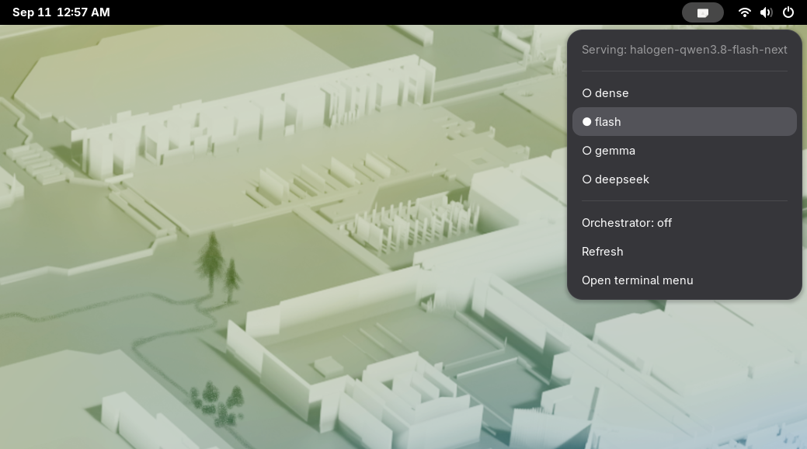

# SUPERFAST

[](#install-a-machine)
[](#install-a-machine)
[](docs/FLAGS.md)
[](https://github.com/Graphene-Lab/Ryzen-AI-Max-395-SUPERFAST/actions/workflows/publish-runtime.yml)
[](LICENSE.md)


**Run a high-quality open LLM on an AMD Ryzen AI Max machine: fast, and in private.**

**The `ornith122` profile is the headline: a 122-billion-parameter model (124.6
billion measured), answering at 25–28 tokens per second on one desktop
machine.** It is a mixture-of-experts model, so it holds 122 billion
parameters and uses about 6 billion of them for each token, which is what
makes it fast on hardware this size. Its checkpoint is 69.7 GB on disk, one
file, and about 75 GB resident with a 262,144-token window, so it uses the
machine's 124 GB of unified memory as a single pool. A model of this class is
normally reached through a rented API, or served from several data-centre
GPUs; here it runs at home, and nothing you send it leaves the machine.


*A Minecraft-style adventure game built on this machine, following this guide.
The goal is to solve puzzles and rescue the princess from the dragon. It is a
demonstration of what a 125B-class model produces locally: no cloud service, no
per-token cost, and the weights on the disk next to you. It was made with the
125B Qwen3.8-Flash-Next profile this project documented until 2026-11-05; that
profile has been removed, and `ornith122` (122B) is the largest one today.*

## Install a machine

`deploy/setup-fedora.sh` is the installer: a fresh Fedora Workstation 44 host
becomes this machine, with the same engines, profiles, units, tools and
timeouts that are measured in this README. It is **one file, no dependencies to
install by hand, and one command per mode**:

```bash
# on the machine, as the admin user (not root: rootless podman is the point)
curl -fsSL https://raw.githubusercontent.com/Graphene-Lab/Ryzen-AI-Max-395-SUPERFAST/main/deploy/setup-fedora.sh -o setup-fedora.sh
PROFILES="gemma ornith ornith122 small" bash setup-fedora.sh
```

Add `UNATTENDED=1` in front of `bash` for a run that is never interrupted: it
requires passwordless sudo (and says how to get it), pushes the kernel
parameters, reboots the machine by itself and continues through a one-shot
system unit. Nothing needs typing, then or after:

```bash
PROFILES="gemma ornith ornith122 small" UNATTENDED=1 bash setup-fedora.sh
journalctl -u superfast-setup-resume -f      # the part after the reboot
```

What it needs, and what it does:

| | |
|---|---|
| a host | Fedora Workstation 44 on AMD Strix Halo (gfx1151). It refuses anything else, and it refuses to run as root |
| disk | about 123 GB — this was 158 GB while the removed `dense` profile was installed, and the total is recomputed here from what remains: the checkpoints are 14.9 GB (Gemma-4), 69.7 GB (Ornith-1.5-122B), 19.0 GB (Ornith-1.5-35B-A3B) and 1.0 GB (the two orchestrator models), plus about 18 GB of container images |
| time | hours, not minutes: the Ornith-1.5-122B checkpoint alone is 69.7 GB, and the profiles download in the background |
| sudo | used for the packages, the firewall, the SSH service, the groups and the kernel parameters. Passwordless for `UNATTENDED=1` |
| it sets up | the packages and the kernel parameters, SSH, the firewalld rules (8741 open, 8731 closed), the model downloads with SHA-256 verification, the container images, the systemd units per profile, the switch, the terminal menu, the GNOME panel, and the API-key gateway |

Two things it cannot do for you: the BIOS must have the UMA frame buffer at its
minimum, and the disk must not be encrypted (an encrypted disk stops at a
passphrase prompt on every reboot, which is not headless). Both are in
[step 1](#1-install-fedora-workstation-44-recommended) and
[step 3](#3-configure-the-machine-for-superfast).

### If the installer stops

The guided path is what was validated on the reference machine. Every phase
has also been exercised since on a Fedora 44 machine with no GPU and no
checkpoints (`SKIP_WEIGHTS=1 SKIP_IMAGE=1`, which is what those flags are for):
they all run, and the installer stops where it should, at the
GPU groups a fresh session does not have yet. That run is what found five
installer bugs, including one that corrupted a generated profile unit. What has
not happened yet is a first run on a fresh host with the hardware and the room
for the weights, so that may be yours. If the script stops, or the machine does
not end up serving a model, report it — the form asks for exactly what makes it
fixable:

**→ [The installer did not finish](https://github.com/Graphene-Lab/Ryzen-AI-Max-395-SUPERFAST/issues/new?template=installer-failure.yml)**

Three things are usually enough: the last line that looks like
`== phase 7/8: model switch, profile units, weights ==`, the error under it,
and whether it was the run before the reboot or the one after. The second half
logs to the journal,
so `journalctl -u superfast-setup-resume --no-pager | tail -40` is the report.

Installer breakage goes to the top of the list. We look at a report as soon as
we see it — usually within hours — and the fix is released once it has run
through on a machine like yours, because the installer is the one part of this
project that cannot be tested on anybody else's hardware. An issue stays open
until the script finishes for the person who opened it.

The full walkthrough, phase by phase, with what each step verifies, is
[Set up a new machine](#set-up-a-new-machine). The installer prints its own
progress and, at the end, what is running and what to check.

What it runs — three open-weight models, everything below measured on this
machine except where a row says otherwise:

| profile | model | id for the client | speed here (prose / code) | best for |
|---|---|---|---|---|
| `gemma` | **Gemma-4-26B-A4B**, 25.2B | `gemma-4-26b-a4b` | 57.3 / 57.6 t/s | the fastest answers; reads images by default |
| `ornith122` | **Ornith-1.5-122B**, mixture-of-experts, 122B in total, ~6B active per token | `ornith-1.5-122b` | 25.0 / 28.2 t/s | the largest model that still fits with room to spare: 262K context, q8_0 KV, MTP inside the weights, vision when the projector is added |
| `ornith` | **Ornith-1.5-35B-A3B**, 35B in total, 3B active | `ornith-1.5-35b-a3b` | — / 63.9 t/s | 256K context and vision on a quarter of the 122B's memory |



*The same names, in the GNOME panel of the machine: click one to switch
profile. The filled circle marks what is running now, the entry below toggles
the small orchestrator, and the last one opens the terminal menu. The
screenshot predates the `ornith` entry.*

One model at a time, on one OpenAI-compatible endpoint. On the machine itself
that endpoint is `:8731`, on loopback; from your network it is the API-key
gateway on `:8741`, and without the key there is no access at all. Switch with
one click in the GNOME panel, or with one command over SSH. No subscription,
nothing leaves the machine. The full comparison with paid models, and the
measured numbers, are further down.

New to this? Read the **[plain-language guide](docs/PLAIN-GUIDE.md)** first.
It is written for readers who are not engineers.

## What this project is

SUPERFAST is a goal, not a fixed architecture. The goal is to take an AMD
Strix Halo APU (gfx1151, for example the Ryzen AI Max+ 395) and run excellent
open LLMs on it as fast as the hardware allows, without giving up quality.

One property of this hardware makes that possible: the CPU and the GPU share
one pool of fast LPDDR5X memory. The 16 Zen 5 cores and the Radeon 8060S
graphics use the same 124 GB — the usable part of the 128 GB installed on
this machine. AMD's ROCm stack turns that shared memory into GPU compute. A
general-purpose engine cannot use all of it. A machine built for it can.

The project turns that machine into a repeatable recipe:

- a Fedora installation,
- models running in containers that carry their own ROCm,
- a small switch that selects which model is active.

Numbers that describe this machine were measured on it. Where a table in this
document quotes somebody else's figures, it says so next to the table.

### A note on names

The project is called SUPERFAST. Each profile is named after the model it
serves: `gemma`, `ornith` (the 35B) and `ornith122`.

A running model is called a **profile**. Only one profile runs at a time, and
every profile serves the same OpenAI-compatible endpoint on port 8731. The
tools you connect to the machine never change their configuration. Today the
machine runs three profiles, in order of size: Ornith-1.5-122B (122B in total,
~6B active), Ornith-1.5-35B-A3B (35B in total, 3B active) and Gemma-4
(25.2B) — that is, up to a
122-billion-parameter model running entirely on the machine.
Other models can be added the same way. See
[Choose a model profile](#choose-a-model-profile).

DeepSeek-V4-Flash is no longer installed by default. Its 284B checkpoint and
its unit are still in the repository as an optional extra for a 512K window;
the measured comparison that moved it out of the fifth slot is in
[`## Benchmark: PipelineScore`](#benchmark-pipelinescore).

**Why one model at a time.** This is a deliberate architecture choice, not a
limitation. A single model gets the whole machine: all of the unified memory
for its weights and its KV cache, and therefore the largest context window the
machine can hold for it — 262,144 tokens for the Ornith and Gemma profiles.
Running two large models at once would mean splitting that memory, and the
first thing to shrink would be the context window — which is exactly what an
agent needs most: a long window that holds the conversation, the tool
definitions, and the files being worked on. That is also why every profile
ships an agent-ready configuration: tool calling, a large answer budget,
prompt cache, and sampling defaults from the vendor.

The one companion allowed to share the machine is the small orchestrator: a
1.2B-parameter model that decodes at about 220 tokens per second and occupies
a couple of gigabytes — insignificant on a machine with 124 GB of unified
memory. It can stay resident while a large model works, and it costs that
model one to two percent of memory bandwidth. Everything else waits its turn.

If you do not have the machine yet, [build it step by
step](#set-up-a-new-machine). If you already have it, pick a model with
`superfast-switch` (see [Choose a model profile](#choose-a-model-profile)).

---

## Set up a new machine

You need a Linux machine before you start. Follow these steps in order; this
is the path we used on a Ryzen AI Max+ 395.

**The whole journey, in order.** Each step links to its section below.

1. Install Fedora Workstation 44 and enable SSH — [step 1](#1-install-fedora-workstation-44-recommended).
2. Connect to the machine over SSH — [step 2](#2-connect-to-the-machine-over-ssh-optional-but-recommended).
3. Run the setup script: it downloads the model and starts the engine — [step 3](#3-configure-the-machine-for-superfast).
4. Download the weights and learn the API — [Get the weights](#get-the-weights).
5. Measure and compare the speed — [Performance](#performance).
6. Point your coding agent at the machine — [Recommended client configuration](#recommended-client-configuration-qwen-code-or-any-agentic-client).
7. Turn the machine into your personal assistant — [AgentBridge](#make-it-your-personal-assistant-with-agentbridge).

### 1. Install Fedora Workstation 44 (recommended)

This is the distribution we recommend. The reasons:

- **It is current.** Fedora 44 is the latest stable release (April 2026) and
  receives updates into 2027. It has the newest stable kernel and Mesa. That
  matters here: support for a new AMD APU like Strix Halo (gfx1151) comes
  from the upstream kernel and Mesa, not from patches added by a
  distribution.
- **ROCm comes from Fedora itself.** AMD's installer (`amdgpu-install`)
  targets Ubuntu and Red Hat families, not Fedora. Fedora packages the open
  ROCm stack in its official repositories instead, so you install it with
  `dnf` and updates arrive with the release. No third-party repositories.
- **It is a normal, well-known desktop.** Fedora Workstation is the same
  GNOME desktop used on millions of machines, with a simple installer
  (Anaconda) that offers disk encryption and automatic partitioning.

Steps:

1. Download the **Fedora Workstation 44** ISO (x86_64) from
   [getfedora.org](https://getfedora.org).
2. Write it to a USB stick with [Fedora Media Writer](https://fedoraproject.org/workstation/download),
   or with any USB writer you trust.
3. Boot the machine from the USB stick. In the installer, choose your disk,
   decide whether to encrypt it, create your user account, and pick a
   hostname.
4. Reboot into the installed system, open a terminal, and enable SSH, so that
   the rest of the setup can run from your PC:

   ```bash
   sudo dnf install -y openssh-server
   sudo systemctl enable --now sshd
   ```

Remember the user name you created: you need it in step 2.

### 2. Connect to the machine over SSH (optional, but recommended)

If the machine has no keyboard or monitor, do all the configuration from your
PC over SSH.

**Option A — with Pi Easy Connect (you only need an Ethernet cable).**
[Pi Easy Connect](https://github.com/Graphene-Lab/pi-easy-connect) shares the
Windows PC's internet connection with the machine over a direct Ethernet
cable (Windows ICS) and opens SSH for you. It works with any Linux machine
that has a network port.

1. Connect an Ethernet cable between the PC and the machine.
2. Run `.\pi-easy-connect.ps1 -SshUser <your-fedora-username>`.
3. You land in the machine's shell, with internet on the `192.168.137.x`
   subnet.

The ICS lease can change at each reboot. To make the address fixed, set it
once on the machine (the subnet of the direct cable):

```bash
nmcli con mod "Wired connection 1" ipv4.method manual \
  ipv4.addresses 192.168.137.100/24 \
  ipv4.gateway 192.168.137.1 \
  ipv4.dns "192.168.137.1 1.1.1.1"
nmcli con up "Wired connection 1"
```

Then connect with `.\pi-easy-connect.ps1 -StaticIp 192.168.137.100 -SshUser
<your-fedora-username>`.

**Option B — plain SSH over your normal network.** Put the machine on your
LAN (DHCP is fine at the start) and run `ssh <your-fedora-username>@<machine-ip>`
from any computer on the same network. If SSH times out, open the port on the
machine:

```bash
sudo firewall-cmd --add-service=ssh --permanent
sudo firewall-cmd --reload
```

### 3. Configure the machine for SUPERFAST

A fresh Fedora install is almost enough, because the SUPERFAST image carries
its own ROCm user-space. The machine needs:

- a kernel whose amdgpu driver exposes `/dev/kfd` and `/dev/dri` for gfx1151 —
  a stock Fedora 44 already does,
- a container runtime (Podman or Docker),
- your user in the `video` and `render` groups,
- disk space for the model checkpoints — see
  [Get the weights](#get-the-weights).

All of the above is validated on a Ryzen AI Max+ 395 running Fedora
Workstation 44. There are two ways to get there:

- **Automated:** `bash deploy/setup-fedora.sh` takes a fresh machine to a
  running SUPERFAST service: system update, SSH, GPU groups, auto-suspend off,
  the kernel memory parameters, checkpoint download with exact-offset resume,
  and each profile installed as its own systemd user unit, waiting for `/health`. On a
  fresh machine the **first run stops on purpose** after adding your user to
  the GPU groups: that change only applies to a new session, so it prints
  "log out, log back in, then run this script again" instead of failing ten
  minutes later with a container that cannot reach the GPU. The second run
  finishes the job. Add more profiles with `PROFILES`:

  ```bash
  # the default set: three llama.cpp profiles and the small router
  bash deploy/setup-fedora.sh

  # the same set, named explicitly
  PROFILES="gemma ornith ornith122 small" bash deploy/setup-fedora.sh
  ```

  For a run that nobody has to watch, add `UNATTENDED=1`. It needs
  passwordless sudo, then it handles both interruptions by itself: it pushes
  the kernel parameters, reboots, and the reboot is also what makes the GPU
  groups effective. A one-shot system unit
  (`superfast-setup-resume.service`) re-runs the remaining phases at boot —
  weights, image, engine, profile units, tools — and disables itself when it
  is done. The log of the second half is
  `journalctl -u superfast-setup-resume -f`.

  ```bash
  PROFILES="gemma ornith ornith122 small" UNATTENDED=1 bash setup-fedora.sh
  ```

  Get the script with `curl` rather than copying it from a Windows machine:
  the shell and systemd files need Unix line endings, and CRLF makes the
  installer stop on its first line with `invalid option name ... set:
  pipefail`. Cloning the repository on the machine itself works too.

  Two flags make a run cheap on a machine that will not serve every profile:
  `SKIP_WEIGHTS=1` installs the downloaders and fetches no checkpoint (start
  one later with `systemctl --user start superfast-download@ornith122`), and
  `SKIP_IMAGE=1` skips the container images, the 3.7 GB GGUF runtime included.

  The profiles phase alone can be re-run on a machine that is already
  installed, which is how a unit-file change reaches the machine without
  downloading anything again:

  ```bash
  PROFILES="gemma ornith ornith122 small" ONLY="profiles" bash deploy/setup-fedora.sh
  ```

  It rewrites the unit files (and refreshes the tools in `~/.local/bin`) and
  does not stop a profile that is already running: the new settings apply the
  next time that profile starts. Run `superfast-switch use ornith122` for that,
  which also makes ornith122 the profile that starts at boot. Until you pick
  one, the machine comes up on whichever profile was enabled before
  (`ornith122`, on a machine from the automated install). The phase also
  installs the [sampler](#watch-a-busy-machine).

  The weights of the extra profiles are fetched by one systemd service per
  profile, so the script returns instead of waiting hours for them, the
  transfers resume after a reboot, and each file is checked against the
  SHA-256 published by Hugging Face before it is used. Gemma, DeepSeek and the
  orchestrator also need the GGUF runtime image, which the script builds when
  it is not present on the machine yet.
- **Step by step:** every phase of the script is a command that was run and
  verified on the reference machine, in order. Read the script with
  `less deploy/setup-fedora.sh` if you prefer to do it by hand; it is
  commented phase by phase. The chronological log we kept while building the
  machine is not published, because it contains host-specific details.

Things we learned on the reference machine:

- **Copy the setup files with Unix line endings.** The scripts and the unit
  templates are shell and systemd files. Copied from a Windows machine they
  arrive with CRLF, and the installer stops on the first line with
  `invalid option name ... set: pipefail`. Downloading the script with `curl`
  (as in [Install a machine](#install-a-machine)) or cloning the repository on
  the machine itself avoids it; if you copied the files from Windows, run
  `dos2unix` on them first.
- **No ROCm on the host.** AMD's `amdgpu-install` does not target Fedora, and
  it is not needed: the image bundles ROCm (see `THIRD-PARTY-NOTICES`).
- **Slow or unstable link?** Do not use `hf download` for the big files. Its
  transport can stall, and its resume starts over because the server changes
  the file tag between runs. Use the `curl -C -` loop in
  `deploy/setup-fedora.sh` instead: it resumes at the exact byte offset and
  loses nothing. `hf download` is fine on a fast link, for the smaller files.
- **BIOS memory split.** Set the UMA frame buffer to its minimum in the
  firmware, so that the whole unified memory is one pool. The large
  checkpoints need it.
- **Two kernel parameters, not one.** The GPU can only use part of the shared
  memory unless you raise both limits, and the allocatable size is the
  **smaller** of the two:
  `amdgpu.gttsize=122880` (120 GiB) and `ttm.pages_limit=31457280`
  (120 GiB, counted in 4 KiB pages). Both must be on the kernel command line,
  because the driver fixes the pool size when it loads. With the defaults,
  only about 62 GiB are usable, which is not enough for the largest
  checkpoints. Measured proof: the default `ttm.pages_limit` of 16309919
  pages × 4096 bytes = 63710 MiB, which is exactly the amount the GPU
  runtime reported. The setup script applies both, with a reboot.
- **Disk encryption is a choice, and it has a cost.** The installer offers
  encryption, and the reference machine does *not* use it. If you enable it,
  every reboot stops at the passphrase prompt on the console, so a machine
  without a keyboard cannot reboot on its own. TPM2 auto-unlock is a possible
  future option.
- **SELinux stays Enforcing.** Passing `/dev/kfd` and `/dev/dri` into
  rootless Podman works without changes.
- **Each profile runs as its own systemd user service** (`gemma.service`,
  `ornith.service`, `ornith122.service`): it starts at boot, restarts on
  failure, and serves the OpenAI-compatible API on port 8731.

---

## Get the weights

Images contain the engine, not the weights. Each profile keeps its weights in
its own directory, and the setup script and the switch know those paths.

| profile | weights directory | files (size in bytes) | source |
|---|---|---|---|
| gemma | `~/gemma-models` | `gemma-4-26B-A4B-it-Q4_0_ROCMFP4_COHERENT.gguf` (14,439,364,064), `mtp-gemma-4-26B-A4B-it-Q8_0.gguf` (461,766,816), `mmproj-BF16.gguf` (1,194,828,256) | HF `kingjones777/Gemma-4-26B-A4B-it-ROCmFP4-GGUF` |
| ornith122 | `~/ornith122-models` | `Ornith-1.5-122B.MXFP4_MOE.gguf` (69,666,316,288) | HF `prithivMLmods/Ornith-1.5-122B-MXFP4_MOE-MTP` |
| orchestrator | `~/small-models` | `LFM2.5-350M-Q4_K_M.gguf` (229,312,224), `LFM2.5-1.2B-Thinking-ToMoE-Q4_K_M.gguf` (730,898,432) | HF `LiquidAI/LFM2.5-350M-GGUF` and `Nichonauta/LFM2.5-1.2B-Thinking-ToMoE-GGUF` |

Two things the table does not show. The `gemma` profile (and the optional
`deepseek`) needs a
second runtime, the GGUF server image built from
[`runtime/`](runtime/README.md). It is published by this repository's workflow
as `ghcr.io/graphene-lab/superfast-runtime:llama-rocmfpx-1`, and the setup
script pulls it and tags it as `llama-rocmfpx:7.2.4`. It is public, so no login
is needed; if the pull fails (no network, or you prefer to build it yourself)
the script builds it from `runtime/` instead. And neither speculative head in
the table works in our
stack today: the Gemma MTP file needs a draft-context flag this runtime build
rejects, and the DeepSeek DSpark file is built for another runtime (`unknown
model architecture`). The measured Gemma and DeepSeek numbers are therefore
without speculation.

To fetch the largest checkpoint by hand — one file, with the MTP head inside
it — download it into its directory and start it with the flags its unit
carries:

```bash
pip install -U "huggingface_hub[cli]"
hf download prithivMLmods/Ornith-1.5-122B-MXFP4_MOE-MTP \
  --local-dir ~/ornith122-models
```

```
~/ornith122-models/
  Ornith-1.5-122B.MXFP4_MOE.gguf   69.7 GB   weights, the MTP head inside
```

```bash
podman run --rm -p 127.0.0.1:8731:8731 \
  --device /dev/kfd --device /dev/dri --group-add keep-groups \
  --security-opt seccomp=unconfined --ipc=host \
  -v ~/ornith122-models:/models:ro \
  localhost/superfast-vk:patch0012 \
  -m /models/Ornith-1.5-122B.MXFP4_MOE.gguf \
  --host 0.0.0.0 --port 8731 -c 262144 \
  --alias ornith-1.5-122b --jinja \
  -ctk q8_0 -ctv q8_0 -fa on --parallel 1 --timeout 0 \
  --spec-type draft-mtp --spec-draft-n-max 2 --spec-draft-p-min 0.6 \
  --spec-mtp-strict-qwen
```

This manual run is optional: `superfast-switch use ornith122` starts the same
profile as a managed service. On Docker instead of Podman, replace
`--group-add keep-groups` with `--group-add video --group-add render`;
`keep-groups` is a Podman keyword that Docker cannot resolve.

> **Check what you downloaded.** Hugging Face publishes a SHA-256 for every
> weight file, and it is worth comparing it before you trust the file. A
> truncated or wrongly assembled download can still load and quietly be the
> wrong model — that happened to us during development, which is why every
> weight used here is checked.
>
> ```bash
> sha256sum ~/ornith122-models/Ornith-1.5-122B.MXFP4_MOE.gguf
> # compare with the LFS SHA-256 shown on the file's page on Hugging Face
> ```
>
> The small orchestrator models were checked this way, and both match the
> published sums:
> `LFM2.5-350M-Q4_K_M.gguf` → `7e6f72643caafc9a68256686638c4d7916f2cec76d1df478d4c3ddcd95a6aed4`,
> `LFM2.5-1.2B-Thinking-ToMoE-Q4_K_M.gguf` → `6f071c4f5893ca93a265613a0009f4db745bc79b50808ab1ce9a8821caf511d0`.
> The big files were checked the same way; this is the value that matched
> Hugging Face exactly:
> `DeepSeek-V4-Flash-0731-Abliterated-ROCMFPx-Strix-Lean-2.58bpw.gguf` → `a936e0a514385c8ae964c0f42263a4314a34fbc6efea9d9aced5320f320a3d54`.
> The DeepSeek speculative drafter has its own published sum
> (`1a01c80eceae302bcc1d70836759ee97974d7983c5084ef43f6ef772a8970ae6`); our
> first copy of it was damaged because two downloads wrote the same file, so
> the downloader now takes a lock and checks the sum before renaming the file.

Model weights are licensed separately from the engine, by their original
authors; see the model repository for those terms.

---

## Performance

> **Which machine produced these numbers.** Everything in this section was
> measured on the reference machine, with every row in the same memory layout
> (BIOS UMA 1 GB, one unified pool) and the instrument named next to the table.

Measured on a Ryzen AI Max+ 395 (Radeon 8060S, 128 GB LPDDR5X), ROCm 7.2.4,
up to 262,144 tokens of context.

### Performance tuning on Fedora 44 — what we tested

Measured profiles on the reference host (2026-09-10, Fedora 44, the same
memory layout for every row: BIOS UMA 1 GB, unified pool,
[`tools/quick-bench.py`](tools/quick-bench.py), greedy, `reasoning_effort:
low`, `max_tokens: 192`, 3 reps; repeatable within about ±2% when nothing else
is running on the machine; the Gemma-4 row uses a 512-token budget — see its
note):

| profile | runtime | prose | code | context probe (~2.2K) |
|---|---|---|---|---|
| Gemma-4-26B-A4B it, Q4_0 ROCmFP4 | llama-rocmfpx | **57.3 t/s** | **57.6 t/s** | ~1527 t/s |
| Ornith-1.5-122B MoE, MXFP4 (~4.45 bpw), q8_0 KV | llama.cpp (Vulkan) | **25.0 t/s** | **28.2 t/s** | ~512 t/s |
| DeepSeek-V4-Flash ROCmFPX (~2.6 bpw), optional | llama-rocmfpx | **11.2 t/s** | **11.3 t/s** | ~163 t/s |

Ornith-1.5-122B is the largest profile and it is a mixture-of-experts: 122B in
total, about 6B active per token, 48 layers of which 12 use full attention.
The checkpoint is 69.7 GB, so it leaves about 45 GB of the 124 GB pool for the
KV cache and the rest of the system; 75 GB was resident with a 262,144-token
window and a q8_0 KV cache (~3 GB for the whole window). The MTP head is
inside the weights and the engine accepted 85% of its drafts, which is where
the 25.0 and 28.2 come from: without speculation the same run measured 20.4 in
prose and 20.6 in code. With the f16 KV cache the same profile measured 24.6
and 27.6 at 77 GB resident; the q8_0 cache is what the profile ships, because
the vendor recommends it for this model and it buys back about 3 GB.

DeepSeek-V4-Flash deserves its own note, because it needed a change to the
machine itself. The weights are 91.5 GB, of which the runtime wanted about
86.9 GB in one single GPU allocation. With the default kernel settings the
GPU path can claim only about 62 GiB, so the load failed with
`cudaMalloc failed: out of memory`. The memory was physically there — the
machine has 124 GB in one pool — but the driver caps how much of it the GPU
may use. Two values define that cap, and the allocatable size is the smaller
of the two:

| parameter | default | set to | meaning |
|---|---|---|---|
| `amdgpu.gttsize` | auto (half of RAM) | `122880` | GTT aperture, in MiB (120 GiB) |
| `ttm.pages_limit` | 16309919 pages | `31457280` | TTM limit, in 4 KiB pages (120 GiB) |

Evidence for "the smaller of the two": with the default `ttm.pages_limit`,
16309919 pages × 4096 bytes = 63710 MiB, and the GPU runtime reported
exactly 63710 MiB of usable device memory. Raising only `amdgpu.gttsize` is
not enough; raising `ttm.pages_limit` at runtime is not enough either,
because the driver fixes the pool size when it loads. Both parameters must be
on the kernel command line, followed by a reboot:

```bash
sudo grubby --update-kernel=ALL --args="amdgpu.gttsize=122880 ttm.pages_limit=31457280"
sudo reboot
```

With both applied, the profile loads. Keeping part of the model's experts on
the CPU was tried as a workaround before that, and it failed even for
sub-gigabyte buffers under memory pressure, so it is not a substitute here.

The optional DeepSeek profile is the slowest of the profiles, and that is expected: it has
about 284 billion parameters, and even at ~2.6 bits per weight it reads far
more per token than the 26B Gemma. The row above is a 192-token budget;
measured with a 512-token budget it is 10.9 t/s on prose and 11.0 on code, so
the numbers agree within about two percent across three independent runs.
Two things lower it in practice, both measured:

- **Long generations decode more slowly, but less than it first looked.** With
  the profile at its full 1M context a 1024-token request ran at 7.2 t/s; at
  the shipped 512K the same request finishes in 101 s, which is 10.1 t/s. That
  earlier figure was measured while the machine was starved of memory, not as
  a property of the model.
- **Two requests at once are each slower** (one of two concurrent 512-token
  requests measured 6.4 t/s), because this profile has a single slot and the two
  take turns on it. One client at a time gets the fast number.

One caveat, the same as Gemma-4: this model reasons at length. With a
192-token budget, a 512-token budget and a 1024-token budget, every request we
measured spent the **whole** budget on reasoning and returned an empty
`content` with `finish_reason: "length"` (the 1024-token one produced 7020
characters of reasoning). Give clients a large `max_tokens`, and read
`finish_reason` before concluding that the model failed. If you want short
answers, this is not the profile for that.

This profile has **no speculative decoding** in our stack, and we tried. The
model ships a DSpark drafter (the 10.9 GB file in the table above), we
downloaded it and its SHA-256 verifies, but the file is built for the Ember
runtime: when our llama.cpp build is given it, it stops with
`unknown model architecture: 'deepseek4-dflash-draft'` (re-checked with the
current runtime on 2026-09-11: the same error). So the numbers above
are what the profile gives without speculation, and there is no flag we can
add today that changes that.

One note on the Gemma row: it is **without its MTP drafter** (the speculative
head): we keep it disabled until the draft-context flag is resolved in the
runtime, and the few percent it adds are not included.

Decode is limited by DRAM bandwidth, and this APU has a single LPDDR5X bus
(there is no closer cache or HBM to move to). Small levers change nothing: on
Gemma-4 ROCmFP4, `llama-bench` reports pp512 ~1480 t/s and tg128 **60.6 t/s**
(the publisher's own ceiling) with default settings, and thread counts or
batch sizes move those numbers by less than 1%. N-gram self-speculation
changes nothing either (measured: prose 51.5 against 52.2 without it).

How the profiles behave, beyond speed: they answer the same probes correctly
when they have enough budget — a logic riddle, arithmetic and a code-bug
question all came back right. They differ in *how*. Gemma-4 reasons at
length before answering and needs a generous `max_tokens`: with a 192-token
budget its answers came back empty, because all the budget went into
thinking. That is why the Gemma row above uses a 512-token budget. Cutting
Gemma's thinking short also hurts accuracy, not only style: with thinking
effectively disabled it answered the arithmetic probe wrongly (65 instead of
67). The practical rule for clients: give Gemma-4 room to think; it stays
correct, and its raw decode is the fastest of the three profiles.

Context depth and the KV cache were measured on Gemma-4: decode ran at 56.1
tokens per second on a 442-token prompt, 50.0 on 1,325 tokens and 46.0 on
1,761 tokens with the default f16 KV cache. Switching to a quantized q8_0 KV
cache was four to six percent *slower* at those depths, so the default stays.
The fork's FP4/TURBO cache types were not accepted by this runtime build (the
server refused to start), so they are a candidate for a future runtime
revision, not a setting we ship.

**Conclusion:** the stock Fedora 44 configuration already performs at the
practical ceiling for this machine. Real gains come from choosing the right
profile — the mixture-of-experts models are the fast ones here — not from
tuning knobs.
You can re-measure any profile at any time with:

```bash
python3 tools/quick-bench.py --api http://<host>:8731
```

### The largest profile: Ornith-1.5-122B (MoE)

A model without experts reads every parameter from memory for every token it
generates, and on this machine memory bandwidth is the hard limit, so its
decode rate is set by its own size. Ornith-1.5-122B sidesteps that with a
mixture-of-experts design. It holds far more parameters in total, but for each
single token only a small subset of its experts is active. Reading fewer
weights per token means more tokens per second on the same memory bandwidth.
This is why a larger model can be the faster model on this kind of hardware,
and it is also why `ornith122` is the profile this project is built around:
**122 billion parameters (124.6 billion measured) on a desktop machine that
sits at home, at the speed the table above reports**, is what makes running
this class of model yourself practical rather than a demonstration.

The profile runs a GGUF quant of that checkpoint on llama.cpp with the Vulkan
backend: one MXFP4 file, 69.7 GB, at about 4.45 bits per weight. The MTP head
is a `nextn` block inside the same file, so there is no second file to fetch,
and the unit passes `--spec-type draft-mtp --spec-draft-n-max 2
--spec-draft-p-min 0.6 --spec-mtp-strict-qwen`: two tokens are drafted per
step and kept only where the full model agrees.

The 122B is a hybrid: 48 layers, of which 12 use full attention and the rest
carry O(1) recurrent state, so the KV cache stays small — about 3 GB for the
whole 262,144-token window with the q8_0 cache the vendor recommends. The
checkpoint is 69.7 GB and the profile is 75 GB resident, which leaves about
45 GB of the 124 GB pool for the rest of the system.

This is the layout AMD describes for large models on these APUs: the BIOS UMA
frame buffer stays at its minimum, so the firmware does not reserve a fixed
slice for the GPU, and llama.cpp draws what it needs from the shared pool.

Measured on the reference machine with the same prompt and procedure as the
table above: **25.0 tokens per second** of decode on prose and **28.2** on
code, with MTP accepting 85% of its drafts. Without speculation the same run
measured 20.4 and 20.6, so the drafter is worth about 20%.

**Vision is available but not installed.** The base model has a projector and
the quant repository ships none, so the profile starts text-only: its `mmproj`
has to be added before it can read an image. See
[Vision](#vision-image-input).

---

## What every profile inherits from the engine

All profiles run on llama.cpp, in two builds: Ornith-1.5-122B and
Ornith-1.5-35B-A3B on the Vulkan engine image, and Gemma-4, DeepSeek and the
orchestrator on the ROCmFPX runtime. Their settings are the command-line flags
in their systemd units; `SUPERFAST_*` names belong to this project's own
tools, and [`docs/FLAGS.md`](docs/FLAGS.md) says which is which.

**Byte-identical speculative decoding.** Draft-then-verify commits only the
tokens the full model would have produced, so the output is bit-for-bit
identical to serial greedy decode. This is checked on every release —
measured, not asserted. Speculation here is a pure speed
optimization with no quality cost.

**Native 262,144-token context**, with decode that barely degrades at depth.
The 122B is a hybrid: 12 of its 48 layers use full attention, and the rest
carry O(1) recurrent state, so most of the network has no KV cache at all.

**Prompt cache** — a follow-up turn in a long conversation resumes instead of
re-prefilling, worth roughly 20× on time-to-first-token at 32K. llama.cpp
keeps the cached prefix in the profile's single slot and makes no promise of
byte-identity: a warm answer is not bit-for-bit the cold one.

**One slot, one queue** — the GGUF profiles ship `--parallel 1` in their
units, which is what keeps a session's prefix in its own slot. Raising the
slot count splits the window and trades the cached prefix for throughput — see
[Concurrency](#concurrency-and-the-one-trap) before changing it.

**OpenAI-compatible API** — `/v1/chat/completions`, `/v1/completions`,
streaming, tool calling, sampling with seeds, reasoning-effort control, and
image input (vision) on the gemma and ornith profiles.

**Speculative decoding in the unit** — the ornith122 profile runs MTP with two
drafts per step, configured in the unit rather than per request. The output is
identical, only the speed changes.

---

## Configuration

There is no configuration file. A profile's engine settings are the
command-line flags in its systemd unit, under
[`deploy/profiles/`](deploy/profiles/README.md); everything a request carries
goes in the JSON body. [`docs/FLAGS.md`](docs/FLAGS.md) lists both kinds and
says who reads what.

`SUPERFAST_*` names belong to this project's own tools (the installer, the
switch, the TUI, the gateway, the benchmarks) and to the client's `envKey`. No
image reads them: **an engine setting written as `SUPERFAST_*` is read by
nobody**, so the engine keeps its default and says nothing.

Per-request settings — temperature, top_p, seed, reasoning effort, tools and
the answer budget — go in the JSON body.

### The token budget covers thinking, not only the answer

A reasoning model thinks before it replies, and those tokens count against the
budget. If the budget runs out in the middle of the reasoning, it does not
shorten the answer: it removes it. The reply comes back with
`finish_reason: "length"`, an empty `content`, and the partial reasoning in
`reasoning_content`, which most OpenAI clients do not display. Send a budget
large enough for the thinking and the answer — the client table below says how
large for each profile.

If a reply looks empty or cut short, read `finish_reason` first: `"stop"`
means you have the whole answer, `"length"` means you ran out of budget. Pass
a larger budget. A truncated response and a model that stopped on its own both
end with `"length"`, so that field alone will not tell you which happened.

### Concurrency, and the one trap

**The profiles run llama.cpp with `--parallel 1`**, so one KV cache and
one queue: a second request waits for the first, and a session always finds
its own cached prefix. Its context is a single `-c 262144`. Raising the slot
count (`--parallel N`) splits that window into N slots, which is the trap the
GGUF profiles already paid for — see
[Many agents at once](#many-agents-at-once).

### Prompt cache

The profiles cache the prompt, and the cache is keyed on **the token prefix
itself**. There is no per-conversation key to send, and `prompt_cache_key` —
the field OpenAI's API accepts for this purpose — changes nothing here: a
client cannot name a conversation, because the prefix already is the name.

- **Gemma and DeepSeek:** llama.cpp keeps the processed prefix in its slot
  cache, so a follow-up turn resumes instead of re-prefilling. Nothing to tune:
  the unit ships `--parallel 1`, which is what keeps a session's prefix in the
  slot it was built in; with several slots the engine may hand a turn to
  another one and the prefix is read again (measured on ornith: 226,890 tokens
  at 119 t/s against 5,479 at 475 t/s after pinning one slot). Warm answers
  are **not** byte-identical to cold ones here — llama.cpp makes no such
  promise, and its log does not claim it.
- **Ornith and the other hybrid models** are the exception on both counts. Their
  recurrent layers let llama.cpp resume only from an exact checkpoint, never
  from a partial prefix, and its prompt cache holds at most `n_ctx` tokens
  across every saved prompt — 262,144 here. So a session keeps its state only
  while the traffic between two of its own requests stays inside that budget.
  A client that runs its own background completions on the same model can
  exceed it on every turn, and the next prompt is then prefilled from token
  zero: measured at 126,977 tokens, 273 s with the extra traffic against 0.7 s
  without it. [`docs/PROMPT-CACHE.md`](docs/PROMPT-CACHE.md) has the numbers,
  the instrument, and what can be done about it.

### Many agents at once

#### One slot, one queue: the GGUF profiles

The gemma, deepseek, ornith and ornith122 profiles run on llama.cpp, and llama.cpp
keeps one KV cache per slot. Their units ship `--parallel 1` so a session
always finds its own cache. The client must help: if the harness opens
subagents in parallel, their requests can land on another slot and the
conversation loses its cached prefix.

Measured on ornith, on one real agent session: with several slots, a turn
re-read **226,890 tokens at 119 t/s** — 31.7 minutes of prefill — and reported
zero cached tokens. After pinning one slot, the same session read **5,479
tokens at 475 t/s**, and a turn went from tens of minutes to a few.

Configure the harness to queue agents instead of running them in parallel. In
Qwen Code, in `~/.qwen/settings.json`:

```json
"agents": { "maxParallelAgents": 1 }
```

`agents.maxParallelAgentsByModel` does the same per model when one machine
serves several. With any other harness, set its subagent or agent concurrency
to 1 if it has the option. The cost is that parallel agents wait their turn;
the gain is that every turn reuses its cache instead of reading the whole
history again, which on a long session is far more than the wait.

**In plain words.** The engine remembers the start of every conversation it has
already read, so the next turn does not read it again. That memory has a fixed
size: llama.cpp keeps at most the window's worth of tokens across every saved
prompt — 262,144 here. A conversation that goes past it is forgotten, and a
conversation that is forgotten reads its whole history again. That is the
pause of a minute or more. The GGUF profiles keep the cached prefix in their
single slot (`--parallel 1`), and a client keeps it usable by keeping the
prefix stable.

The llama.cpp units have no knobs for this: their settings are the flags in
their unit files (`-c 262144`, `--parallel 1`, the KV cache type and the MTP
flags), and the engine sizes everything else itself.

#### When the host runs out of memory, and how to recover without rebooting

The largest profile holds most of the machine: 75 GB resident at the
262,144-token window, and the rest of the system shares what is left, including
the page cache the checkpoint is read through. That works while there is room.
It stops working once the host's memory has accumulated: the page cache and the
zram swap fill up, and the engine stalls for minutes at a time while a request
is in flight. **A host reboot clears it.**

When a machine does stall, a reboot is not the only way out:

```bash
superfast-switch recover
```

`tools/superfast-recover.sh` stops the profile, drops the page cache and compacts
memory — the two things the kernel needs to hand the contiguous blocks back —
starts the profile again, and reports the headroom the engine finds. Run it
between conversations: stopping the profile drops its prompt cache. On the
reference host it took the free 2 MiB blocks from 16 to 537 before the restart,
and afterwards the engine reported `0 compaction stalls` and served again. If it
does not come back, the tool says so and the answer is the host reboot.

Those two writes are in `/proc/sys/vm`, so they need root. The setup installs a
root-owned helper, `/usr/local/sbin/superfast-reclaim`, together with a sudoers
rule that allows **exactly that script**, without arguments, so `recover` does
not ask for a password. The helper is the narrowest form of the permission: a
rule that allowed arguments to a root command would be a rule that can run
anything. Without the rule the tool asks for the password, and if it cannot ask
it says so and restarts the profile anyway, so the machine is never left down.

### Watch a busy machine

The engine's log says how long each request took, but not whether anything was
waiting, and on a machine with several agents that is the difference between an
answer that is slow and an answer that is queued. `superfast-monitor.timer`
closes that gap: every 30 seconds it reads the engine's `/health` and `/cache`,
plus the GPU counters and the memory, and appends one line to
`~/.local/share/superfast-monitor/samples.jsonl` (rotating at 20 MiB). The setup
script installs and starts it; nothing has to be enabled by hand.

```bash
superfast-monitor.py --report 24     # the last 24 hours, in one screen
systemctl --user stop superfast-monitor.timer   # stop sampling
```

**llama.cpp does not count a queue, so those columns are empty.** `/health` answers
`{"status":"ok"}` with no `in_flight`, no `queued` and no `busy_for_s`; those fields belonged
to the dense engine that left on 2026-11-07. The sampler keeps the fields it used to record
and writes them only when the engine publishes them, so on every profile this machine now
runs the queue columns stay blank — and a blank column is the honest answer, not a zero.

What is still readable is the slot itself: `curl -s localhost:8731/slots` reports
`is_processing`, and with `--parallel 1` there is exactly one. A second client that seems to
hang is therefore not a queue you can watch grow: it waits behind that slot, in silence, and
the only visible sign is that the first request never clears. That is why the client budgets
exist instead of a queue alarm.

The sampler is read-only, needs no API key — it reads loopback — and only
writes in its own directory. It exits 0 without a sample when no profile is
serving, so an idle machine does not collect failed units.

---

## Published artifacts

Everything this project publishes or uses, in one place. This repository is the
entry point: the images it owns are built and pushed by
[`.github/workflows/publish-runtime.yml`](.github/workflows/publish-runtime.yml),
so they are connected to this repository and appear in its Packages section.

| artifact | registry | what it is |
|---|---|---|
| `ghcr.io/graphene-lab/superfast-runtime:llama-rocmfpx-1` | GHCR (ours) | the GGUF runtime: llama.cpp with the ROCmFPX fork, built for gfx1151. Needed by the `gemma`, `deepseek` and orchestrator profiles |
| `ghcr.io/graphene-lab/ryzen-ai-max-395-superfast:flash-vk-1` | GHCR (ours) | the Vulkan engine image as it was first published. It predates patch 0012, so `deploy/build-vulkan-image.sh` tries it, checks that its `llama-server` knows `--reasoning`, and otherwise builds `localhost/superfast-vk:patch0012` from the `qwen4exp-conv-ring-slots` branch |
| `ghcr.io/graphene-lab/ryzen-ai-max-395-superfast:image-1` | GHCR (ours) | `sd-server` from stable-diffusion.cpp: the optional image generator on `:8733`. Pulled the same way, with the build from `runtime/Dockerfile.sd` as fallback |
| `kingjones777/Gemma-4-26B-A4B-it-ROCmFP4-GGUF` | Hugging Face | the Gemma-4 weights used by the `gemma` profile |
| `otheru/DeepSeek-V4-Flash-Strix-Halo-GGUF` | Hugging Face | the DeepSeek-V4-Flash weights used by the `deepseek` profile |
| `LiquidAI/LFM2.5-350M-GGUF`, `Nichonauta/LFM2.5-1.2B-Thinking-ToMoE-GGUF` | Hugging Face | the small models used by the orchestrator |

Pull the runtime image the way the profile units expect it:

```bash
podman pull ghcr.io/graphene-lab/superfast-runtime:llama-rocmfpx-1
podman tag  ghcr.io/graphene-lab/superfast-runtime:llama-rocmfpx-1 \
            llama-rocmfpx:7.2.4
```

The pull is about 4.2 GB (the image takes 11.2 GB unpacked). The package is
public, so no login is needed; `deploy/setup-fedora.sh` does this by itself,
and falls back to building from [`runtime/`](runtime/README.md) when the pull
fails. Why the package is not named after the repository: a package pushed by
hand is not connected to the repository, GitHub refuses to change its
visibility through the API in that state, and the workflow's own token cannot
push to it either — a package created by the workflow is connected from the
start. [`runtime/README.md`](runtime/README.md) has the full explanation.

The weights are **not** in the images. They are fetched from Hugging Face by
the downloader in [`deploy/profiles/`](deploy/profiles/README.md), which
checks each file against the SHA-256 published there before using it. The
images contain the engines only.

Nothing in this project is redistributed under a licence that forbids it; the
credits and the licences of every upstream component are in
[`THIRD-PARTY-NOTICES`](THIRD-PARTY-NOTICES.md) and inside the images at
`/licenses`. Model weights keep their own licences, from their authors.

## Requirements

- **AMD Strix Halo (gfx1151)** — Ryzen AI Max+ 395 or equivalent. The build
  refuses every other architecture; this will not run on a discrete GPU, and
  that is deliberate.
- **128 GB unified memory** recommended. The largest checkpoint is 69.7 GB and
  is mapped, not copied.
- **A ROCm-capable kernel** with `/dev/kfd` and `/dev/dri` accessible, plus
  the two kernel parameters described in
  [step 3](#3-configure-the-machine-for-superfast) for the largest models.
- **A checkpoint**, mounted at `/models` — see
  [Get the weights](#get-the-weights). A profile refuses to start until its
  files are complete and their sums verified.

In practice the memory is comfortable: with the Gemma profile loaded, the host
reported about 18 GB in use and 106 GB available, and the largest profile,
Ornith-1.5-122B, is 75 GB resident. Both were measured. The switch still runs
one profile at a time by design, so the big
models never compete. The orchestrator is the one auxiliary that is allowed
to share.

---

## Benchmark: PipelineScore

PipelineScore is a third-party benchmark run with its own CLI (`@pipelinescore/cli` 0.5.0). It
has 34 deterministic tasks in four families — writing code that must pass unit tests, emitting
JSON tool calls, answering reasoning questions exactly, and extracting facts from short
documents — and each task is scored by its own checker, not by a judge model, into a 0-100
composite with a tier band. It compares quality, not speed.

The runs of 2026-10-22, and the reference runs of 2026-11-06 and 2026-11-07, were made **on the
host itself**, so the leaderboard page describes the machine that really serves the model. Each
run switched the profile, warmed it with three short calls until the latency settled, and was
submitted (`--user andrea-bruno`). One seed per profile.

*Nemotron 3.5 Super VL 120B-A12B* is the second reference measurement, run on 2026-11-07 on an
engine built for it from mainline (llama.cpp `ca89968`, no patches) with its vision projector.
Its four quality families are **identical to the 122B's** (code 100, reason 80, tool use 87.5,
RAG 100), so the whole gap to the others is speed — a 120B MoE with 12B active on a hybrid
Mamba-2 architecture, whose Vulkan kernels are plainly less mature than the transformer ones.

The score was run twice the same day, which is what makes the second number worth reading. The
first run (80.2) served it plain and **was the slowest thing measured here**: speed 12.1 against
23.5 for the 122B, matching its own probe of 17.9 t/s decode. The second (80.7) added its native
MTP speculative decoding and a 256-token ubatch — `-md mtp-Q8_0.gguf --spec-type draft-mtp
--spec-draft-n-max 2 -ub 256` — and **speed went to 15.5** while every quality family stayed
identical to the digit, because speculative decoding verifies what it drafts and cannot change
the output. The third (**80.9**) is the same engine with the 65.8 GB quant instead of the 88.6 GB
one: the four families are identical again and **speed rises to 17.2**, so the smaller weights
cost nothing on either axis. Cards:
[de191deb](https://pipelinescore.ai/s/de191deb-97b8-4539-92c8-df69a98bf20a),
[6c3f0804](https://pipelinescore.ai/s/6c3f0804-1816-447a-a17d-2df493dc7cc4) and
[bc667eac](https://pipelinescore.ai/s/bc667eac-2bc7-4ee3-9a67-22a05a1430e3).

The CLI's 2048-token budget cannot hold a reasoning trace, so both runs were made with thinking
off; the row to read them against is therefore the 122B's thinking-off **73.5**, not 81.9.

| profile | client model id | score | tier |
|---|---|---|---|
| ornith | `ornith-1.5-35b-a3b` | **90.1** | TRUNK |
| *Qwen3.8-27B dense — removed* | `qwen3.8-27b` | 85.9 | MAINLINE |
| gemma | `gemma-4-26b-a4b` | 81.2 | MAINLINE |
| ornith122, q8_0 KV | `ornith-1.5-122b` | **81.9** | MAINLINE |
| ornith122, f16 KV | `ornith-1.5-122b` | 84.0 | MAINLINE |
| ornith122, thinking off | `ornith-1.5-122b` | 73.5 | FEEDER |
| *Qwen3.8-Flash-Next, shipped flags — removed* | `qwen3.8-flash-next` | 83.8 | MAINLINE |
| *Qwen3.8-Flash-Next, original flags — removed* | `qwen3.8-flash-next` | 80.7 | MAINLINE |
| *GLM-5.3-Flash, reference* | `glm-5.3-flash` | 82.4 | MAINLINE |
| *Nemotron 3.5, reference — plain serving* | `nemotron-3.5-super-vl-120b` | 80.2 | MAINLINE |
| *Nemotron 3.5, reference — MTP + ub 256, 88.6 GB* | `nemotron-3.5-super-vl-120b` | 80.7 | MAINLINE |
| *Nemotron 3.5, reference — MTP + ub 256, 65.8 GB* | `nemotron-3.5-super-vl-120b` | **80.9** | MAINLINE |

**Every run above is published.** The twelve of them, with their tiers, are listed on the
[andrea-bruno profile](https://pipelinescore.ai/users/andrea-bruno) alongside everyone else's
runs, which is the comparison the numbers are for; the individual cards are linked in the
paragraphs below.


Earlier figures taken from the Windows PC over the LAN (ornith 89.3, gemma 81.1)
are kept as a note: they measured the same models under the same conditions and agree in
ranking, but they were not published.

The two `ornith122` rows were measured on 2026-10-25, the q8_0 one after the
f16 one and both with the thinking on, which is how the profile ships. The
q8_0 KV cache is the configuration it ships with, on the vendor's
recommendation and at half the cache size; it scores **81.9** against **84.0**
for f16, with code at 100 in both, reasoning 80 against 90, and speed 23.5
against 22.2. Turning the thinking off is a separate, larger cost: the same
model with `--reasoning off` scored **73.5**. The cards are
[a8c8b2f8](https://pipelinescore.ai/s/a8c8b2f8-9e38-4bb8-94ee-2c31d2073353)
(q8_0) and
[67b71bf8](https://pipelinescore.ai/s/67b71bf8-f37d-4a40-9662-4cb4e8f19e20)
(f16).

The two italic `Qwen3.8-Flash-Next` rows are the **125B model the lineup used until
2026-11-05**, kept because they record why it left. It scored **83.8** with the memory flags
it shipped — one slot, ubatch 128, q8_0 KV — and **80.7** with the four slots, ubatch 512
and f16 KV it ran before 2026-10-21, so those flags were a gain and not a quality trade.
The best run reads code 100, reason 80, tool use 87.5, RAG 100, speed 36.1, and the model
page is [qwen3.8-flash-next](https://pipelinescore.ai/models/qwen3.8-flash-next). It lost
its slot on the code axis rather than on this one — its code row was one of those withdrawn
with the old budget, so this README no longer prints it — and on the size of the machine it
needed: a 125B model for a decode of 33-35 t/s.

The italic `Qwen3.8-27B dense` row is the profile **removed on 2026-11-07**, kept for the
same reason as the flash rows. It is the only profile measured here that won nothing: second
on this axis behind the 35B at about twice its memory, last on code, the only one whose
repository carries no vision projector, and the only one that needed a third engine image of
its own. Its code number never settled — nearly all of its failures ended at the withdrawn
cap, writing a whole program — so that row recorded a format failure, and the profile left
the machine before the budget was fixed. The decision rests on the axis above and on cost.

The `GLM-5.3-Flash` row in italics is a **reference measurement, not a profile**: it was run on
2026-11-06 to decide whether the model deserved a slot, and it did not. On this axis it is a peer of
the 122B rather than a successor — code 100, reasoning 80, tool use 87.5 and RAG 100 are identical,
the same three tasks fail, and its +0.5 over the shipped 122B is entirely the speed axis (26.9
against 23.5). Card:
[4d9f41f8](https://pipelinescore.ai/s/4d9f41f8-2fe6-4386-925d-0c1181733086). The run served
`j2ipper/GLM-5.3-Flash-a4e3s`, a 109.5 GiB requant whose experts are IQ2_S/IQ3_S at KLD 0.0419,
through a **third engine**: llama.cpp `529ac893e` plus 46 Vulkan patches. It decodes faster
(29.5-31.6 t/s against 25-28) but prefills at half the rate (208-280 t/s against ~512) and serves
**64K** of context against 262K; it carries no `mmproj`, so no vision; and at 111 GiB of GTT it
leaves no room beside the image generator. Raising the pool to `amdgpu.gttsize=122880` (120 GiB) is
what makes it load at all — 116 GiB died on `Couldn't update BO_VA (-12)`.

## Benchmark: MultiPL-E (C#)

[`nuprl/MultiPL-E`](https://huggingface.co/datasets/nuprl/MultiPL-E) config `humaneval-cs` ships 158
C# problems, each a function to complete plus the tests that check it. The model receives the prompt
with the signature and the opening brace already written and returns the body only; the file compiled
is prompt + body + tests, built and run with `dotnet` against a net8.0 console project, and a failed
`Debug.Assert` is a failed task. **The generation budget is 2,048 tokens, and it is our choice** —
MultiPL-E takes it as a request parameter and prescribes nothing: its own vLLM runner declares
`max_model_len=2048` and passes `max_tokens` through. The number is deliberate, because the median
answer on this machine is under 100 tokens. An earlier table used a smaller budget, a habit
inherited from the original HumanEval, and it cut answers off mid-function; it was withdrawn with
the rows it produced. No judge here either: the tests decide.

Every model runs once with the sampling its own card recommends for coding, on the same 158
tasks, and **each with the reasoning setting that serves it best** — which was measured, not
assumed:

| profile | best passed | how | median s/task | total |
|---|---|---|---|---|
| *Nemotron 3.5 Super VL 120B-A12B, reference* | **97** | thinking on | 27.3 | 1h27m |
| ornith-1.5-35b-a3b | **96** | thinking on | 6.8 | 0h23m |
| ornith-1.5-122b | **94** | thinking on | 17.9 | 1h05m |
| gemma-4-26b-a4b | 90 | thinking off | 4.0 | 0h15m |

**The seven tasks between first and last are not a ranking.** Pairing the runs task by task, the
leader beats the 35B on nine problems and loses eight (McNemar χ² 0.00), beats the 122B on eight
and loses five (0.31), and beats gemma on thirteen and loses six (1.89) — none of the three clears
the 3.84 threshold. On 158 tasks the four are indistinguishable at code synthesis, and a gap of
about ten tasks would be needed to separate them; 21 of Nemotron's own answers also end at the
2,048 cap, which can only understate it. So the column gives an order, not a verdict: read it
together with the time, which spans 4.0 to 27.3 s per task, and with the general axis in the
PipelineScore table above, where Nemotron is last of the four (80.9 against 90.1 for ornith) and
the 35B first.

**Reasoning helps three of the four, and the table looked different without it.** The same
runs with the reasoning channel closed, on the same engine:

| profile | thinking off | thinking on | gain | price |
|---|---|---|---|---|
| ornith-1.5-35b-a3b | 66 | **96** | **+30** | 1.9× the time |
| ornith-1.5-122b | 85 | **94** | +9 | 2.7× |
| *Nemotron 3.5, reference* | 95 | **97** | +2 | 4.4× |
| gemma-4-26b-a4b | **90** | 7 of 20 (control) | **−** | — |

The 35B is the model this machine runs for agentic work, and it was the last on code only
because its unit ships `--reasoning off`: with the channel open it passes 96, second by one
task. **Its two arms also exposed something the table cannot show**: the 83 this profile
reported before was measured through the stale vision drop-in, which runs the ROCmFPX image
without MTP, while the numbers above come from the Vulkan engine the profile actually ships.
Same weights, same sampling, same budget — 83 against 66. The engine alone is worth 17 tasks
on this model, more than any sampling choice we have measured, which is why the unit and its
drop-in are now kept in sync by the repo rather than by hand.

Gemma is the exception in the other direction — a 26B mixture that costs 15 minutes and
is the only one that gets *worse* when it thinks, because its reasoning does not converge on a
single function (the control above).

The point this table makes is that the reasoning switch is part of the optimal configuration,
not a global policy: a comparison that pins it off for everyone measures the switch, and it
hides 30 tasks on the 35B and 9 on the 122B.

**That row is the 65.8 GB quant, and the other size was measured too.** Nemotron exists in two
quantisations, so both were run on the same 158 tasks and scored on both axes before the larger
one was deleted:

| Nemotron, same 158 tasks | `UD-Q4_K_XL` — 88.6 GB | `UD-Q3_K_XL` — 65.8 GB |
|---|---|---|
| MultiPL-E, thinking off | 95 | **96** |
| compiled | 150 | **154** |
| PipelineScore | 80.7 | **80.9** |
| Speed (the PS axis) | 15.5 | **17.2** |
| decode | 25.5 t/s | **29.7 t/s** |
| prefill, 74.5K tokens | 251.7 t/s | 261.3 t/s |
| MTP drafts accepted | 76% | 74% |
| weights on disk | 88.6 GB | **65.8 GB** |

Seven tasks gained and six lost on MultiPL-E, and the four PipelineScore quality families
identical to the digit in both runs: the smaller weights cost nothing measurable. The decode gain
is 16% while prefill moves within the noise, which is what the bandwidth arithmetic predicts —
prefill is compute, generation is bytes read — and the per-task median on MultiPL-E does not move
at all (6.2 s in both), because every task there is a fresh prompt and pays prefill. So the 23 GB
came free, and with them the headroom that lets this model sit beside the image generator instead
of alone. Both PipelineScore rows below are the smaller quant's: that run was repeated, and it is
the 80.9.

**The budget is a dial, and it was not free to choose.** A smaller one cut the 35B off
mid-function — 56 of its 91 failures ended exactly at the old cap — while gemma writes past
the body when it has room. So 2,048 was picked by counting answers that ended at the ceiling,
not by assuming more is better. With reasoning on, the ceiling comes back into play: 12 to 21
answers per model end there, which is the price of the longer traces rather than a fault of
the budget.

The 122B is 15 tasks better here than the October run that reported 70, and gemma
71 better than the 19 it reported. **Nothing about gemma changed** — same weights, same
`llama-rocmfpx:7.2.4` image, same launcher line, verified in the history of
`deploy/profiles/gemma.service`. Its October row was measured with the reasoning channel open,
and gemma is the one model here that pays for it. A control on the same 20 tasks:

| gemma, same 20 tasks | passed | compiled | median tokens | at the cap |
|---|---|---|---|---|
| thinking on | 7 | 15 | 2,048 | 18 of 20 |
| thinking off | **12** | **18** | 66 | 1 of 20 |

With reasoning on, gemma writes a whole program inside markdown fences and stops only
when something cuts it — the October record still carries the error that proves it,
`CS1056: Unexpected character '`'`. Quadrupling the budget moves it from 4 to 7 tasks and
leaves the gap to the thinking-off arm untouched, so this reasoning does not converge on
a single function.

**The temperature arm is not in this table.** It was measured on 2026-11-07 over 790
tasks and moved *which* tasks pass, not how many — three passes net across five models,
with the two settings disagreeing on 83. But it was measured under the withdrawn
protocol, so it points rather than files a result and its columns are not printed here.

The withdrawn rows went with it. *Qwen3.8-Flash-Next* and *GLM-5.3-Flash* were measured
under that budget, the GLM run with most of its failures cut, so its number was a floor;
the flash profile has been removed from the machine anyway. *Qwen3.8-27B dense* left on
2026-11-07 because it won nothing: last on the general axis behind a 35B with half its
memory, the only profile without a vision projector, and the only one that needed a third
engine image. Its code number never settled — nearly all of its failures ended at the cap,
writing a whole program — so that row recorded a format failure, and the profile left the
machine before the budget was fixed. The decision rests on the axis above and on cost.
Their PipelineScore rows above remain, because that benchmark was not affected.

What this does and does not say:

- **Function level, not repository level.** 158 single functions from the HumanEval lineage, no
  cross-file context, no tools. It ranks the profiles on code synthesis, not on agentic work; for
  that axis the README reports PipelineScore (ornith 90,1 ·
  ornith122 84,0 · gemma 81,2).
- **2,048 tokens is a ceiling nobody reaches.** Three answers in 632 ended at the cap, so the budget
  is not doing the deciding any more, and that is what makes the column comparable. With no cap at
  all the same models generate tens of thousands of tokens for one body and never stop; gemma
  reached 900 s on the first task, so a run without a ceiling does not finish.
- **The median hides the tail.** The 35B's median is 4.1 s, but a few tasks cost minutes.
- **The harness is ours.** The assembly was proved with a hand-written body (build and run both 0)
  before any model ran; the per-task records live in `benchmarks/multipl-e/`.

## Honest limits

- **One GPU target.** gfx1151 only, by construction.
- **Vision is on by default where the weights allow it.** The gemma and ornith
  models read images: their projector is downloaded at setup and **loaded by
  default**, so the machine comes up able to see. `VISION_DEFAULT=0` keeps it
  text-only. `superfast-switch vision on|off` (or the panel toggle) changes it
  later, which restarts the profile with or without the encoder. The optional
  `deepseek` profile is text-only — no encoder exists in its repository —
  and ornith122 has one, but its projector is not installed by default.
  **Both clients now declare it too**: `generationConfig.modalities.image` in Qwen Code and
  `input: ["text", "image"]` in PI, for gemma and ornith, because that key is what makes
  `read_file` pass pixels instead of a placeholder. Verified end to end on 2026-11-08 — gemma read a
  real screenshot and quoted the text in it. [`docs/MODEL-CARDS.md`](docs/MODEL-CARDS.md) carries the
  per-model table: image, video (no client has a channel for it), reasoning switch, context and
  speculation.
- **Cold time-to-first-token at very long context is slow.** A genuinely cold
  262K prompt is a multi-minute prefill. The prompt cache makes the *second*
  turn fast; it cannot make the first one fast.
- **Code is measured on functions, not repositories.** The MultiPL-E table ranks
  profiles on 158 single functions with no cross-file context and no tools; the
  agentic axis is PipelineScore. Neither measures what a profile does inside a real
  repository, which is the axis the plan targets next: EvalPlus — HumanEval+ (164
  problems) and MBPP+ (378), `pass@1`, one profile at a time. On this machine that is
  about 1.5 hours per profile on HumanEval+ and several hours more on MBPP+ for the
  slower profiles, so it is a job for one night per model, not for an afternoon.
  A second axis belongs in the same plan: the same batch of issues run on two
  profiles, scored by issues closed per hour and by repeated tool calls. That
  separates a weak model from a weak prompt, which a pass@1 table cannot do.

---

## How good are the models

Quality here is measured on this machine, not quoted. The runs we performed are in
`## Benchmark: PipelineScore` and `## Benchmark: MultiPL-E (C#)` above, and
`docs/MODEL-CARDS.md` collects what the model authors say about serving them.

The same two runs are also how the settings are chosen, and that is the second reason
they exist. A model has three things a user can change without touching the weights —
its sampling (temperature, top-p, top-k), whether it reasons before answering, and the
context it is served — and the cards disagree about all three, sometimes for the same
model within the same week. 158 identical tasks turn that disagreement into a number,
because the tests decide and no judge is involved: run them twice with one thing
changed and the difference is either the setting or the proof that it makes no
difference. It is why the temperature paragraph above can name a cost per model, why
the presets in the client configs are a decision with a measurement behind it instead
of a copy of a card, and why the reasoning switch is now treated as a benchmarking
constraint rather than a preference.

Vendor benchmark tables are deliberately not reproduced: they measure other builds,
other quantizations and other harnesses, and none of them answers the question that
matters here, which is how a profile behaves on your documents and in your language.
Where a vendor figure changed a decision on this machine, it is cited in the section
that made that decision, next to the measurement that confirmed it.

## The orchestrator: a small, fast model that hands work to the right specialist

This profile does not appear in the profile table, because it does not
compete with the big models. It has a different job.

An orchestrator decides what has to be done and who should do it: it reads a
request, splits it into parts, sends each part to the right specialist model
or tool, and assembles the answers. In the literature the same idea appears
under several names, used almost interchangeably: orchestrator, router,
dispatcher, supervisor, planner, controller, and Anthropic's "lead agent" in
its orchestrator-worker design. A lighter variant is the "semantic router",
which decides with vector similarity instead of a full model call.

The point of giving this job to a *small* model is efficiency, not
intelligence. Routing, classifying, choosing a tool and planning a short
sequence of steps are simple tasks. A 350M-to-1.5B model does them in
milliseconds. Doing them with a big model means paying the big model's memory
bandwidth for work that does not need it. The numbers on this machine make
that clear: a 122B specialist answers at 25 to 28 tokens per second, while the
1.2B orchestrator answers at 204 and makes a routing decision in about a tenth
of a second. The orchestrator can therefore run all the time, answer
immediately, and cost the specialist model barely 1–2% of its bandwidth when
both are resident.

The pattern is old and familiar: a conductor does not play the violin better
than the musicians; the work is deciding who plays when, and keeping the
piece together. The same shape appears in offices, where the person
coordinating the work produces less than the specialists but decides who does
what.

A second job for the orchestrator is reactive control: home automation, IoT
devices and voice front-ends. In these settings almost nothing needs
reasoning. A speech-to-text program turns "turn on the kitchen light" into
text, and something has to map that text to a switch, a scene or a short
series of steps. Most of those procedures are semi-deterministic — a flow
diagram with a few branches, not a problem to solve from scratch — and what
matters is latency and availability, not depth. A small model does the mapping
in milliseconds, is always resident, and never competes with a specialist
model that is busy thinking elsewhere. Using a large model for this work is
slow and expensive, like using a missile to drive a nail: it works, but with
far more power than the job needs.

Two boundaries keep the design honest. First, where a procedure is fully
deterministic, ordinary code is cheaper and faster than any model: the
orchestrator is useful in the unclear cases — understanding what the user
meant, filling in a missing detail, choosing between a few known flows — and
as soon as the flow is known, plain logic should run it. The strongest designs
put rules first and the model behind them: a keyword table answers most
commands in well under a millisecond, and the model handles the rest. Second,
actions that matter — locks, alarms, appliances — need guardrails: the model
should choose from a list of allowed commands instead of producing free text,
anything irreversible should ask for confirmation, and a deterministic
fallback should keep working when the model is unavailable.

Beyond routing and reactive control, the same role covers adjacent jobs:
choosing the model tier for a request; rewriting or expanding a search query
before retrieval; summarizing a long conversation before handing it to the
specialist; running cheap guardrails such as moderation, personal-data checks
or prompt-injection detection in front of the expensive model; making a
first-pass judgement of the specialist's answer; and starting or coordinating
subagents. All of them are short, cheap decisions, where a large model's
latency is pure waste.

This is how production systems are built, not an invention of this project.
Anthropic describes an orchestrator-worker design in which a lead agent plans,
starts three to five specialized subagents in parallel, and combines their
findings. Frameworks encode the same split: LangGraph's supervisor pattern,
vLLM's semantic router, the aurelio-labs semantic router, and the
model-router/cascade ideas (RouteLLM, FrugalGPT) that send each request to
the cheapest model that can handle it. Vendors of commercial routers claim
70–90% cost reductions and 2–3× faster median responses from this split;
those are marketing numbers, but the mechanism is real, and it is why the
pattern is everywhere in agentic stacks.

On this machine the plan is concrete, and it is measured. A small Liquid
LFM2.5 model becomes a resident orchestrator on its own port, while the
ornith122 or DeepSeek profile stays on the main endpoint for the work that
needs a big model. Clients keep talking to the same address; the orchestrator
decides whether the request is simple enough to answer itself or worth waking
the specialist.

| small model | decode (llama-bench tg128) | end-to-end generation | prefill (pp512) | short routing answer |
|---|---|---|---|---|
| LFM2.5-350M Q4_K_M | **465 t/s** | — | 21,280 t/s | — |
| LFM2.5-1.2B Thinking Q4_K_M | **216 t/s** | **204 t/s** | 8,182 t/s | **0.130 s** for 24 tokens |

Those numbers answer the question the section opened with: a small local model
comfortably exceeds two hundred tokens per second on this machine, and a
routing decision comes back in about a tenth of a second, which is the
latency a voice or home-automation front-end needs. Tuning was checked rather
than assumed: on the 1.2B model, thread counts of 8 and 16 and alternative
batch sizes all landed within 0.2% of the defaults, so the defaults are what
is shipped. Both files were verified byte-for-byte against the official
Hugging Face SHA-256 sums before use.

Co-residency was measured, not assumed. With the small model resident but
idle, the large model's throughput did not change beyond noise (prose 56.5
against 55.6 t/s, code 57.6 against 57.6). While the orchestrator was actively
generating in parallel, prose dipped by at most about three percent (53.9
t/s) and code was unaffected. That is the real price of keeping a dispatcher
ready: almost nothing while it waits, a few percent while it works.

The orchestrator has its own systemd unit and is toggled with
`superfast-switch orchestrator on|off`, so enabling it never disturbs the
active profile. Its numbers stay out of the profile table, which is about
the specialist models.

---

## Choose a model profile

The machine runs **one model profile at a time**, and every profile serves the
same OpenAI-compatible endpoint on port 8731. Clients — scripts, apps,
AgentBridge — never change their configuration when you switch: only the
model behind the endpoint changes. Stopping one profile releases its memory
before the next one loads, so Ornith-1.5-122B, Gemma-4 and any future
profile do not compete for resources.

The setup script ([`deploy/setup-fedora.sh`](deploy/setup-fedora.sh), phases
7 and 8) installs everything: the profile units, the switch itself into
`~/.local/bin/superfast-switch`, the TUI, the API-key gateway and the GNOME
panel. Which profiles it prepares depends on `PROFILES` (see
[step 3](#3-configure-the-machine-for-superfast)); the units live in
[`deploy/profiles/`](deploy/profiles/README.md) and stay stopped until the
switch starts them. If you only want the switch on a machine that is already
configured:

```bash
cp tools/superfast-switch.sh ~/.local/bin/superfast-switch
chmod +x ~/.local/bin/superfast-switch
```

Use the switch on the machine:

```bash
superfast-switch status          # what is running now
superfast-switch list            # available profiles
superfast-switch use gemma       # Gemma-4-26B-A4B ROCmFP4
superfast-switch use ornith122  # Ornith-1.5-122B MXFP4
superfast-switch mode auto       # let the client's model field pick the profile
superfast-switch stop            # stop everything
superfast-switch api-key on      # require the API key from the LAN (:8741)
superfast-switch api-key status  # is the gateway on, is a key set
```

**Two optional extras, both off unless you ask.** `superfast-switch mode auto`
moves the choice of profile to the clients: the gateway reads the `model`
field, maps it to a profile and switches, but only while the engine is idle.
While a request is running it answers `409` with `active`, `requested`,
`state` and `retry_after`, because a switch mid-conversation costs a full
reload and drops the prompt cache. `pinned` is the default, and a manual `use`
returns to it.

A profile that is still reading its weights is not treated as a failure: the
gateway holds the request while the unit reports `loading` and forwards it as
soon as `/health` answers 200, so a client that starts at the same moment as
the engine waits tens of seconds instead of receiving `409` and giving up. The
wait is bounded (`SUPERFAST_GATEWAY_LOAD_WAIT`, 600 s by default) and it only
applies while a unit is actually starting; an engine that is down still gets
the `409` at once, because there is nothing to wait for.

`superfast-switch image on` starts the optional image generator (Ideogram 4
through `sd-server`) on its own loopback port, `8733`, beside whichever profile
is loaded — it is not a profile and never takes `8731`. It starts only when the
loaded model leaves it room: the switch subtracts that profile's measured
footprint from the machine's memory and compares the result with the peak the
generator needs (24 GB at 1024 px, measured), so with `ornith122` or `deepseek`
loaded the choice is refused and remembered for a lighter model.
The four Ideogram files are not downloaded by the installer, because their
licence is non-commercial: see [Get the weights](#get-the-weights).

**The largest resolution that works is 1536 × 1536.** A 1536 render returns in
138.8 s with a 6.9 MB image; 2048 × 2048 never returns — after 385 s the
connection drops with no image and `sd-server` restarts, and it did the same
with 91 GB free, so the cause is the resolution and not memory. The gate still
carries `IMAGE_PEAK_2K_GB=32`, declared and never measured: 2048 is not
supported by this build. At 1024 px the generator renders in 46.6 s with a
15.65 GB peak.

The tool stops the current profile, starts the requested one and waits until
`/health` answers with **200**, so when `use` returns, the endpoint is ready.
It also enables the profile you picked and disables the others: the profile you
act on is the one that starts at boot, and two enabled profiles would both try
to hold port 8731.
This matters for the GGUF profiles: a llama.cpp server binds its port at once
and answers 503 while it loads, so the switch waits for the load to finish (a
minute or two for the large checkpoints) instead of reporting early. A profile
also refuses to start until its weights are complete, and the `deepseek`
profile additionally needs the kernel parameters described in
[step 3](#3-configure-the-machine-for-superfast): until you apply them, the
switch refuses to start it and says so. The measured numbers behind each
profile live in [Performance](#performance) and are updated as new models are
validated on this machine.

### What each profile ships: context, tokens, tools

The context window is the reason this machine runs one model at a time (see
[A note on names](#a-note-on-names)), so every profile is configured at the
largest window its model supports on this hardware. Measured on the
reference machine:

| profile | context | memory in use while serving | notes |
|---|---|---|---|
| Gemma-4-26B-A4B | 262,144 | ~23 GB | its native 256K; its sliding-window attention keeps the KV cache small |
| Ornith-1.5-122B | 262,144 | ~75 GB | native maximum; only 12 of its 48 layers use full attention and the q8_0 KV cache is ~3 GB for the whole window |

Three properties that matter when a program uses this machine as its model:

- **The KV cache follows the slot.** On llama.cpp each slot owns a private
  KV, which is why the GGUF profiles ship one slot (`--parallel 1`): four
  sessions share the window, and a session that lands on another slot loses
  its cached prefix.
- **Tool calling works on the profile we could verify it on.** The GGUF
  profiles run with `--jinja`, so the model's own chat template handles tools.
  Verified on Gemma-4: asked for a tool call, and the answer was a proper
  `tool_calls` reply with the right arguments (`get_time({"city":"Rome"})`).
  On **DeepSeek-V4-Flash it does not work in practice**, and that is measured
  rather than assumed: with a 1,024, 2,048 and 8,192-token budget the model
  spent the whole budget thinking. At 8,192 it had written **6,123 reasoning
  tokens with no tool call** when the attempt was stopped after 22 minutes,
  the generation down to about 0.4 tokens per second and the machine using
  105 GB of its 124 GB. Treat that profile as a long-context text model, not
  an agentic one.
- **Give the thinking profiles room.** Both spend their whole budget on
  reasoning when the budget is small, and the answer comes back empty with
  `finish_reason: "length"`. Measured, per model: with **DeepSeek-V4-Flash**, at
  192, 512 and 1024 tokens every request spent the whole budget on reasoning;
  with **Gemma-4**, a 256-token budget came back empty and 1024 produced a
  normal answer, which is why its measured row uses 512. Send a large
  `max_tokens` with both.

Why DeepSeek ships 512K and not its full 1M: both were measured. At 1M the
machine has about 7 GB of free memory left, and long generations then stall —
an 8192-token request stopped after 5668 tokens and burned 14 CPU cores for 25
minutes without producing anything, observed twice. At 512K the same profile
uses ~102 GB, keeps ~21 GB free, and a 1024-token generation finishes in 101
seconds at 10.1 t/s. If this machine is to run nothing else, `-c 1048576` in
`~/.config/systemd/user/deepseek.service` restores the full window.

### Recommended client configuration (Qwen Code, or any agentic client)

A coding agent sends a large system prompt, the tool definitions and the files
it is working on, and then asks for long answers. Any OpenAI-compatible client
works, and the settings that matter are these — they come from the
measurements above, not from taste. Every profile binds port 8731 to loopback,
so from another machine the base URL is the API-key gateway,
`http://<machine-ip>:8741/v1`, with `Authorization: Bearer <key>`; the setup
script opens 8741 in the firewall and keeps 8731 closed. Local tools on the
machine itself use `http://127.0.0.1:8731/v1` with no key.

| setting | what to do |
|---|---|
| model name | the `id for the client` column of the profile table at the top; it changes with the active profile, and it is what `/health` reports as `"model"` |
| context window | set it to what the profile serves — 262,144 for the three, 524,288 for DeepSeek. Never larger: the server refuses, because the window is allocated memory, not a preference |
| answer budget | per profile, see the table below. The budget covers the reasoning tokens as well, so a small one truncates a turn that thinks and then writes a file, and a large one can outlast the client's stream limit |
| sampling | the server declares **no** sampling default — `/props` reports only `n_ctx` — so the client chooses. Greedy (`temperature: 0`) is what a coding agent wants, and it is what the numbers in this README were measured with |
| reasoning effort | the field is ignored: thinking is switched in the unit, with `--chat-template-kwargs`, not per request |

**Where each client keeps that id.** The `id for the client` column of the
profile table at the top of this document is what goes in the `model` field,
and it is also what `mode auto` resolves: renaming an id breaks the entry and
the alias together.

| client | file | base URL | what enables images |
|---|---|---|---|
| Qwen Code, Windows and Fedora | `~/.qwen/settings.json` | `http://<machine-ip>:8741/v1`, or `http://127.0.0.1:8741/v1` on the machine itself | `generationConfig.modalities.image: true` — this is the one that gates images; `capabilities.vision` only changes the label |
| PI coding agent | `~/.pi/agent/models.json` | same | `"input": ["text", "image"]` on the model entry |
| OpenCode | `~/.config/opencode/opencode.json` | same | nothing to set: the id is the object key, selected as `<provider>/<id>` |
| any other OpenAI client | — | same | send the image as an `image_url` content part |

The PI and OpenCode providers that point at the Funnel carry a `-remote`
suffix (`ornith-1.5-122b-remote`); the local ones do not.

Two limits that only show up in long agentic sessions:

- **A client's own timeouts are shorter than this machine needs.** Qwen Code has
  two of them (verified in 0.21.1): `streamIdleTimeoutMs`, the longest silence
  it tolerates between two chunks — **4 minutes by default** — and `timeout`,
  the whole request — **2 minutes by default**. Both are far too small here.
  The server sends nothing at all while it prefills (measured: 44.9 seconds of
  silence for a 57,000-token prompt), and a request can also wait in
  the queue before its prefill starts. The values in the tables below are
  computed for that, in
  [Timeouts, and why they are what they are](#timeouts-and-why-they-are-what-they-are).
- **Keep the prefix stable, especially with subagents.** Every turn re-sends
  the conversation, and the server reuses what it computed before: the prompt
  cache is keyed on the prompt itself, so there is no cache key to send. It
  only works while the beginning of the prompt does not change — keep the
  system prompt and the tool definitions identical across turns, and put
  volatile content (the clock, command output) at the end. Two consequences
  when an agent opens subagents: each subagent carries its own history, so
  only what it shares with its siblings is free, and the machine keeps warm
  only what fits its context window while it decodes at most as many
  conversations at once as the profile has slots (one, on every unit) — see
  [Many agents at once](#many-agents-at-once). Qwen Code shows the cache work
  in `/stats`.

**Two things that stop an OpenAI-compatible client here.** First, `response_format` is not
implemented: a request that carries it is refused with **400** and a message that says so
(`/health` lists it under `not_implemented`). Leave the field out and parse the reply yourself.
Second, with a large tool catalog the model sometimes calls a tool class by a name that does not
exist — `ExcelTool` for a spreadsheet tool, `XlsxTool`, and similar guesses. The engine rejects
that call, and the agent usually corrects itself on the next iteration, so it costs one round
trip rather than the task. Both are visible in the log; a client that reports them saves a
debugging session.

A working `~/.qwen/settings.json`, with the ornith122 profile filled in.
`modelProviders` is an object, its keys are provider ids and each key holds an
array of models. Every profile on this machine speaks the OpenAI-compatible
protocol, so they all go under the `openai` key. A file Qwen Code has already
written carries other keys as well: add these entries to it instead of replacing
it.

```json
{
  "modelProviders": {
    "openai": [
      {
        "id": "ornith-1.5-122b",
        "name": "[SUPERFAST] ornith122 profile (MoE 122B) - coding",
        "baseUrl": "http://<machine-ip>:8741/v1",
        "envKey": "SUPERFAST_API_KEY",
        "capabilities": { "agent": true },
        "generationConfig": {
          "timeout": 6000000,
          "streamIdleTimeoutMs": 4200000,
          "maxRetries": 1,
          "contextWindowSize": 262144,
          "extra_body": { "reasoning_effort": "low" },
          "samplingParams": { "max_tokens": 16384 }
        }
      }
    ]
  }
}
```

`"vision": true` tells Qwen Code the model accepts images, so it sends image
content straight to it instead of refusing it or routing it elsewhere.
`"agent": true` lets the same model run as the full-turn agent with vision on.
Add `"vision": true` to the `gemma` and `ornith` entries; leave it off for
`ornith122` and the optional `deepseek`, which have no projector
loaded (ornith122 has one, but it is not installed by default).

Add the other profiles as further objects in the same array, using the values in
the table below, and keep only the ones you use. Two entries that share both an
`id` and a `baseUrl` are the same entry, and the second one is ignored, so that
pair is also how you keep one model twice with different settings (thinking on
and thinking off, for example, with `/v1` on one of them). `id` is what the
client sends as the model name, so it must match what `/health` reports, and
`contextWindowSize` must match the window the profile allocates:

| profile | `id` | context window | answer budget | `streamIdleTimeoutMs` | `timeout` | `temperature` | `extra_body` |
|---|---|---|---|---|---|---|---|
| Gemma-4-26B | `gemma-4-26b-a4b` | 262,144 | 32,768 | 3,600,000 | 4,800,000 | **0** | none, the profile ignores it |
| Ornith-1.5-122B | `ornith-1.5-122b` | 262,144 | 16,384 | 4,200,000 | 6,000,000 | leave unset | `{"reasoning_effort":"low"}` |
| DeepSeek-V4-Flash (optional) | `deepseek-v4-flash` | 524,288 | 16,384 | 8,400,000 | 10,800,000 | **0** | none, the profile ignores it |

Before you rely on it, check the three things a wrong setting hides: that the
gateway answers with your key, that the model name you configured is one of the
ids it lists, and that the profile you expect is the one running.

```bash
curl -s http://<machine-ip>:8741/v1/models -H "Authorization: Bearer <key>"
superfast-switch status        # on the machine: which profile is serving
```

**From outside your network.** If the machine has no public IP — a phone
hotspot, or a router you cannot configure — you can still reach the gateway from
any computer, with nothing installed on that computer, through a tunnel the
machine opens in the outbound direction.
[Accessory tools](#accessory-tools-use-the-machine-from-anywhere) has that guide,
and the one for the graphical desktop.

A useful shape is two entries per profile: one for your own network, one for the
address from outside. Give the remote one a different `id` — ours end in
`-remote` — because an entry is identified by `id` **and** `baseUrl`, while
Qwen Code's `-m` flag selects by `id` alone: with two entries sharing one `id` it
takes the first, and only the picker can reach the other one. The engine does not
check the model name it receives, so a distinct `id` is safe.

Both timeouts are milliseconds, and they are not round numbers by accident:
each one is the worst case of that profile — the largest prompt it serves, the
longest answer its budget allows, and the wait for the requests ahead of it —
rounded up to whole minutes and then up again to leave margin.
[Timeouts, and why they are what they
are](#timeouts-and-why-they-are-what-they-are) shows each term. They are
deliberately generous: a timeout that is too small cuts a turn that is still
running, while a timeout that is too large only means a client takes longer to
notice a server that has stopped answering. A smaller answer budget makes the
sum smaller, so these values stay valid when a profile's budget goes down.

The answer budget also follows the speed of the profile, and that is the second
reason for the numbers above: the same number of tokens takes longer on a
slower model, and the client's 15-minute stream limit would cut the answer
before the model finished.
Ornith-1.5-122B answers at 25.0 and 28.2, Gemma at 57.3 and holds 32,768 inside
the limit; DeepSeek answers at 11.2, so a full 16,384-token answer takes about
24 minutes and needs the longer limit below.

`temperature` is only set on Gemma and DeepSeek, because those two declare no
sampling default of their own: without the field the client's own default
applies, and the numbers in this README were measured greedy.

`envKey` names an environment variable, not the key itself: point it at the
gateway key, read with `superfast-switch api-key show`, and set it with
`setx SUPERFAST_API_KEY <key>` on Windows or `export SUPERFAST_API_KEY=<key>`
elsewhere. When the client runs on the machine itself, use
`http://127.0.0.1:8731/v1` and any placeholder value, because loopback needs no
key. Qwen Code re-reads `modelProviders` edits without a restart.

Both timeouts are per-provider fields, so they belong in each entry above.
Qwen Code also reads `QWEN_STREAM_IDLE_TIMEOUT_MS` from the environment as a
fallback for the idle limit (`0` disables that limit); the whole-request
`timeout` has no environment fallback. Another client may have neither field:
then set whatever it calls a timeout above the numbers in the table, or leave
it unset where unset means no limit — an idle timeout is only a backstop, and
one that is too small cuts a turn that is still running.

### Timeouts, and why they are what they are

Every value in the two tables above comes from one formula, applied per
profile:

```
silence = wait_in_queue + largest_prompt / prefill_rate
total   = silence + answer_budget / decode_rate
```

`wait_in_queue` is the longest a request can legitimately sit in silence while
the machine serves others. The llama.cpp profiles have no queue timeout of
their own, so theirs is the estimate of the requests ahead of the last one.

The inputs are the measurements in [Performance](#performance), each taken at
its slowest value, and the largest prompt is the profile's context minus its
answer budget:

| profile | largest prompt | prefill | answer | wait in queue | silence | whole request |
|---|---|---|---|---|---|---|
| Gemma-4-26B | 229,376 tok @ 1,527 t/s | 150 s | 572 s | 2,888 s (four requests ahead) | 3,038 s → **3,600,000 ms** | 3,610 s → **4,800,000 ms** |
| DeepSeek-V4-Flash (optional) | 507,904 tok @ 163 t/s | 3,116 s | 1,463 s | 4,579 s (one request ahead) | 7,695 s → **8,400,000 ms** | 9,158 s → **10,800,000 ms** |

Read the deepseek row as the reason this table exists: 507,904 tokens is 52
minutes of prefill at 163 tokens per second, and the server says nothing at all
while it prefills. A client left at its defaults — 4 minutes of silence, 2
minutes per request — cannot see that turn finish, and the answer is lost with
the work.

Two consequences worth knowing:

- **No unit sizes a queue, because there is none to size.** Each unit runs
  `--parallel 1`, so a second request waits for the slot, and the socket
  timeout below is the only bound on how long one request may run.
- **llama.cpp has a timeout of its own**, `--timeout`, 600 s by default, on the
  *socket*. The gemma and deepseek units raise it (1800 s and 3600 s) because
  their prefills are long enough to trip the default — see the comments in
  those units.
- **Nothing here is a substitute for watching.** A very large idle timeout
  means a server that has stopped answering is noticed late; the terminal is
  always faster than that.

For another client the rules are the same: point it at
`http://<machine-ip>:8741/v1` with the `Authorization: Bearer <key>` header
(or `http://127.0.0.1:8731/v1` on the machine itself, no key), use the model
name from `/health`, send tools enabled and a large output budget, keep the
context at what the server allocates, and do not send sampling parameters the
server already applies.

The auxiliary orchestrator is toggled separately, because it runs *alongside*
the active profile instead of replacing it:

```bash
superfast-switch orchestrator on      # start the small router model (:8732)
superfast-switch orchestrator off     # stop it
superfast-switch orchestrator status  # is it running?
```

It is off by default and costs the specialist model one to two percent of
memory bandwidth when enabled. Its two model files live in `~/small-models`
(see the table in [Get the weights](#get-the-weights)); the setup script
installs its systemd unit when those files are present, and the unit stays
stopped until you switch it on.

The same controls exist in two friendlier forms. On the desktop, a small GNOME
panel menu (`gnome-shell-extension/`) shows what is serving and lets you switch
model, toggle the orchestrator, toggle vision, and turn the API key on or off
(set, copy or clear it) with a click. In a terminal — including over SSH —
`superfast-tui` offers a minimal menu plus simple commands (`status`, `use`,
`orchestrator`, `api-key`, `help`), and `superfast-switch` is the same set for
scripts, plus `vision` (see below).

### Vision (image input)

Two profiles can read pictures: **gemma** and **ornith**. You send an image
with your question the standard OpenAI way — a base64 `image_url` content
part — and the model looks at it and answers. Vision is **on by default** for
these two: the setup installs the projector active, so the machine can already
read images. Set `VISION_DEFAULT=0` at setup for a text-only machine. Turning
vision on or off later restarts the profile and costs extra memory. The
optional **deepseek** profile has no image encoder and
stays text-only; **ornith122** has one, but its projector is not installed by
default, so it is text-only until that `mmproj` is added.

```bash
superfast-switch vision on     # load the encoder; restarts the profile
superfast-switch vision status # supported / enabled / active profile
superfast-switch vision off    # back to text-only
```

On the desktop the same control is the **Vision** switch in the GNOME panel:
greyed out on the text-only models, on/off on gemma and ornith, and locked
while the profile restarts.

**→ The full story — how the encoder loads, why the memory cost is *not*
cumulative, the automatic rollback if the engine cannot come back, the API
request format and its limits, and how vision behaves with the prompt cache
while a chat is in progress — is in the dedicated
[**Vision guide**](docs/VISION.md).**

### Locking it down (API key)

Networking is off by default and switched on with a key. Every profile binds
port 8731 to **loopback** on the machine, so nothing on your network can reach
a model directly. The only way in from the network is the gateway on port
8741, and it answers a request only when it carries the key. Without the key
there is no access at all — this is not "open, but also has a key".

Turn it on and read the key (this also starts the gateway):

```bash
superfast-switch api-key on        # generates a key if none exists, starts the gateway
superfast-switch api-key show      # print the key, to paste into a client
```

Clients then send one of these, and a request without it is refused with 401:

```
Authorization: Bearer <key>
X-API-Key: <key>
```

The commands live in `superfast-switch` and are mirrored in `superfast-tui`
and in the GNOME menu:

| command | what it does |
|---|---|
| `superfast-switch api-key status` | is the key set, and is the gateway running |
| `superfast-switch api-key on` | start the gateway; the key is required from now on |
| `superfast-switch api-key off` | stop the gateway: **no access from the network at all** |
| `superfast-switch api-key show` | print the key |
| `superfast-switch api-key set [key]` | set the given key, or generate one, and turn the gateway on |
| `superfast-switch api-key clear` | remove the key and stop the gateway |

"Off" means remote access is off, not "open without a key": with the gateway
stopped, only the machine itself can reach a model. The key lives at
`~/.config/superfast/api.key` (mode 600) and the gateway is
`superfast-gateway.service`. The setup script opens 8741 in the firewall and
keeps 8731 closed; if you ever open 8731 yourself, you have exposed the models
with no key again.

### An answer the engine refuses is repaired before the client sees it

Two failures happen every few runs, and both end a client's turn for a reason
the client cannot repair. The engine sometimes answers a valid request with an
empty body, which Qwen Code reports as `400 status code (no body)`. And
llama.cpp's PEG parser sometimes refuses the model's own generation — a tool
call it cannot read — and ends the request with `The model produced output that
does not match the expected peg-native format`: a 500 for a non-streaming
request, the same error inside the stream for a streaming one, after the text
has already been delivered.

The gateway repairs both before they reach a client. While nothing of the answer
has been forwarded the same request is re-sent, up to three attempts in all.
Once text has been delivered the stream is closed with a normal finish instead
of the error, so an unattended run keeps going instead of stopping until
someone presses Ctrl+Y. The switch is `--allow-empty-retry`, which the setup
script already puts on the gateway unit; `tools/gateway-retry-selftest.py`
reproduces both shapes and the retry budget against a fake engine, and
`switch.log` records each repair.

**Roadmap: other model families.** Two llama.cpp builds are in use — the
Vulkan engine image for the two Ornith profiles, and the ROCmFPX fork, which
adds AMD's FP4 tensor types, for Gemma-4 and DeepSeek. One such runtime can
host several profiles, because a profile is only a weight folder plus a
systemd unit. Gemma-4-26B-A4B and DeepSeek-V4-Flash are the two families
validated on ROCmFPX so far. Nothing enters the switch before it is measured
on this exact machine and its numbers are published here.

---

## Accessory tools: use the machine from anywhere

None of this is needed for the machine to work on your own network. These are the
two guides that turn it into a machine you can use from anywhere, and each one is
step by step and self-contained.

### Reach the API and a shell from any network

[**Remote access from anywhere**](docs/REMOTE-ACCESS.md) is for the case where
the machine has no public IP: behind a phone hotspot, or behind a router you
cannot configure. It sets up a tunnel that the machine opens in the outbound
direction, exposes **only** the key-protected gateway, and shows how to carry
SSH through the same tunnel. The computers that connect need nothing installed:
they only need the address and the API key.

### See the graphical desktop

[**A desktop on the machine, from anywhere**](docs/REMOTE-DESKTOP.md)
configures GNOME Remote Desktop over RDP, reachable from your tailnet only —
nothing published, nothing exposed on the local network. Use it when a shell is
not enough: a setting to change, a window to look at, a file manager. It also
explains why RDP cannot go through the tunnel, and what that means for the
computer you connect from.

---

## Make it your personal assistant with AgentBridge

The machine you built is a fast, private LLM server. The last step turns it
into a personal assistant you can talk to.

**What AgentBridge is, in plain words.** AgentBridge is a program that runs
your own AI agents on a normal computer. You chat with it in a terminal, and
it can do real work for you: reading and summarizing your documents, drafting
files, working with spreadsheets, browsing the web, sending email. Everything
runs on your own hardware and stays private. AgentBridge is self-hosted and
open source, and it follows a "bring your own model" approach: it uses
whatever LLM you point it at — which is what the SUPERFAST server provides.

**Where it runs.** AgentBridge does not have to run on the Fedora machine.
The Fedora machine is the brain: an OpenAI-compatible API. Install AgentBridge
on your everyday computer (Windows, Linux or macOS), add the SUPERFAST server
as its model provider, and the assistant works locally on your computer while
asking the server for intelligence. From another machine the provider points
at port 8741 and sends the API key; on the machine itself, port 8731 needs no
key.

**How to install it.** AgentBridge ships self-contained binaries, so no .NET
runtime is needed. On Windows, open PowerShell and run:

```powershell
irm https://graphenelab.it/AgentBridge/install.ps1 | iex
```

On Linux or macOS:

```bash
curl -fsSL https://graphenelab.it/AgentBridge/install.sh | bash
```

Alternatively, download the archive for your operating system from the
[download page](https://graphenelab.it/AgentBridge/download/). Then start it,
type `/setup`, open the LLM and Providers tab, add the SUPERFAST server as a
provider pointing at `http://<your-fedora-host>:8741`, and paste the API key
(read it on the machine with `superfast-switch api-key show`). On the machine
itself the provider can point at `http://127.0.0.1:8731` with no key.

A worked example, measured from the desktop PC to the machine over the direct
cable (the health check answered in about six milliseconds):

```bash
# on the machine: choose a profile and read the model name it reports
superfast-switch use gemma
curl -s localhost:8731/health         # -> "model":"gemma-4-26b-a4b"
```

From any computer on the network, the OpenAI-compatible endpoint is the
key-protected gateway, `http://<machine-ip>:8741`, and the model name is
whatever `/health` reports — `gemma-4-26b-a4b`, `deepseek-v4-flash` or the
Ornith name, depending on the active profile. One caution learned the hard way:
give the model a generous `max_tokens`. In our own test, a 256-token budget
was consumed entirely by Gemma's reasoning phase and the answer came back
empty; 1,024 tokens produced a normal reply. The gateway requires the key
(`Authorization: Bearer <key>`); on the machine itself use
`http://127.0.0.1:8731` with no key.

The official repository is
[github.com/Graphene-Lab/AgentBridge](https://github.com/Graphene-Lab/AgentBridge/):
there you will find the releases, the full manual and the tools the agents can
use.

---

## Why this matters

A few years ago, this level of quality required a paid API and sent your
questions to someone else's datacenter. A model that rivals paid frontier
services while running entirely on a machine you own changes the economics:
no subscription, no usage caps, and nothing leaves your home. That is the
deeper point of this project: models this good are what make independence
possible. It is also why this field moves so quickly — every user who stops
renting intelligence and runs it locally is a cost that the large datacenter
build-outs find harder to justify.

---

## License

**MIT.** Everything this repository contains — the installer, the profile units,
the switch, the tools, the GNOME panel, the benchmark harnesses and the
documentation — is released under the MIT license in
[`LICENSE.md`](LICENSE.md): use it, change it, ship it, commercially or not, as
long as the copyright notice travels with it. There is no EULA to accept and no
key to obtain.

That does not extend to what the machine runs:

- **Model weights** are not included and keep the licenses of their authors.
  Each downloader names the repository it pulls from
  ([`deploy/profiles/download-weights.sh`](deploy/profiles/download-weights.sh)),
  and some of those repositories are gated.
- **The container images** carry llama.cpp (MIT) and, in the ROCmFPX image,
  AMD's ROCm runtime under its own terms. See
  [`THIRD-PARTY-NOTICES.md`](THIRD-PARTY-NOTICES.md).